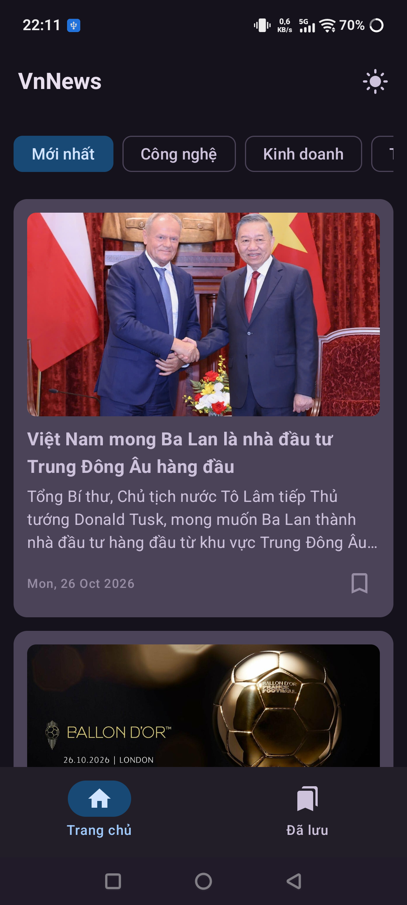
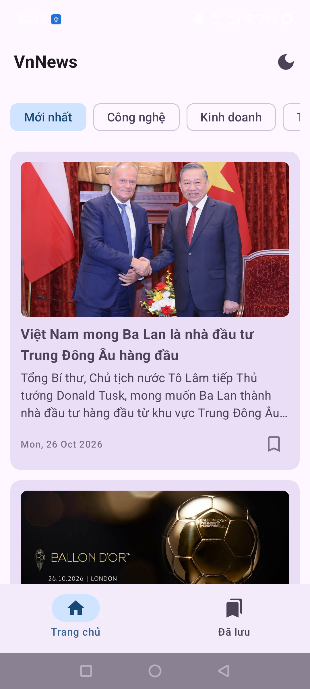
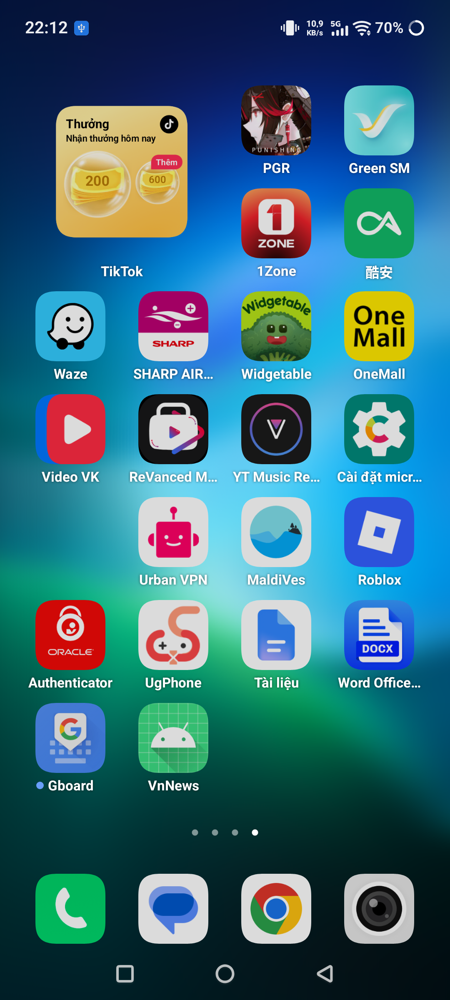

# 📰 VnNews - Ứng Dụng Đọc Báo Việt Nam (VnExpress Reader)

Ứng dụng đọc báo tin tức hiện đại viết bằng **Jetpack Compose (Material 3)**, triển khai toàn diện và đáp ứng 100% các tiêu chí kỹ thuật từ **Unit 4 đến Unit 8** của giáo trình **Android Basics with Compose (Google)**.

---

## 📥 Tải Về & Trải Nghiệm Ứng Dụng
* **Bản phát hành APK chính thức:** [Tải file `app-debug.apk` tại mục Releases (v1.0.0)](https://github.com/kurrukado/VnNews/releases/tag/v1.0.0)
* **Tệp báo cáo học phần:** [`BaoCao_VnNews_Android_Compose_MoiNhat.docx`](BaoCao_VnNews_Android_Compose_MoiNhat.docx) *(Bản báo cáo Word chuẩn học thuật kèm hình ảnh minh họa)*

---

## 📱 Hình Ảnh Thực Tế Ứng Dụng Đang Chạy

| Trang chủ (Light Mode) | Giao diện Tối (Dark Mode) |
| :---: | :---: |
|  |  |
| *Lọc 5 chuyên mục, tải tin tức & ảnh mượt mà* | *Lưu trạng thái giao diện qua DataStore Preferences* |

| Đọc báo gốc (WebView Interop) | Bài viết đã lưu (Bookmarks Offline) |
| :---: | :---: |
|  |  |
| *Nhúng WebView tràn viền 100%, có BackHandler* | *Đọc ngoại tuyến từ Room Database kể cả khi tắt mạng* |

---

## 📌 Bảng Đối Chiếu Kiến Thức Giáo Trình (Checklist Chấm Điểm)

| Khối kiến thức (Unit) | Công nghệ & Kỹ thuật | Thành phần & File trong Project |
| :--- | :--- | :--- |
| **Unit 4: Architecture & Navigation** | • Mô hình **MVVM** + **Repository Pattern** • Quản lý UI State bằng **StateFlow** (UDF) • **Jetpack Navigation Compose** | • [`NewsNavGraph.kt`](app/src/main/java/com/example/vnnews/ui/navigation/NewsNavGraph.kt) • [`HomeViewModel.kt`](app/src/main/java/com/example/vnnews/ui/home/HomeViewModel.kt) • [`NewsRepository.kt`](app/src/main/java/com/example/vnnews/data/repository/NewsRepository.kt) |
| **Unit 5: Connect to Internet & Images** | • **Retrofit 2** + OkHttp Header Interceptor • Phân tích XML RSS trực tiếp từ VnExpress (`VnExpressRssParser`) • **Coil (`AsyncImage`)** tải và cache ảnh | • [`VnExpressRssParser.kt`](app/src/main/java/com/example/vnnews/data/remote/VnExpressRssParser.kt) • [`NewsApiService.kt`](app/src/main/java/com/example/vnnews/data/remote/NewsApiService.kt) • [`HomeScreen.kt`](app/src/main/java/com/example/vnnews/ui/home/HomeScreen.kt) |
| **Unit 6: Data Persistence** | • **Room Database 2.7.2** (Entity, DAO, TypeConverters, Flow) • **DataStore Preferences** lưu cấu hình Dark Mode & chuyên mục | • [`ArticleEntity.kt`](app/src/main/java/com/example/vnnews/data/local/ArticleEntity.kt) • [`ArticleDao.kt`](app/src/main/java/com/example/vnnews/data/local/ArticleDao.kt) • [`AppDatabase.kt`](app/src/main/java/com/example/vnnews/data/local/AppDatabase.kt) • [`UserPreferencesRepository.kt`](app/src/main/java/com/example/vnnews/data/local/UserPreferencesRepository.kt) |
| **Unit 7: WorkManager** | • **PeriodicWorkRequest** chu kỳ 12 giờ • Ràng buộc kết nối mạng (`Constraints`) • Phát **Notification** tin nóng & Quyền Android 13+ | • [`DailyNewsNotificationWorker.kt`](app/src/main/java/com/example/vnnews/worker/DailyNewsNotificationWorker.kt) • [`NewsApplication.kt`](app/src/main/java/com/example/vnnews/NewsApplication.kt) • [`MainActivity.kt`](app/src/main/java/com/example/vnnews/MainActivity.kt) |
| **Unit 8: Views in Compose (Interop)** | • Nhúng **`WebView`** truyền thống bằng **`AndroidView`** • Tràn viền 100% (MATCH_PARENT) • Hỗ trợ WebChromeClient & **`BackHandler`** lùi trang | • [`ArticleWebView.kt`](app/src/main/java/com/example/vnnews/ui/detail/ArticleWebView.kt) • [`DetailScreen.kt`](app/src/main/java/com/example/vnnews/ui/detail/DetailScreen.kt) |

---

## 🧪 Kết Quả Kiểm Thử (Unit Tests)
Dự án được trang bị bộ kiểm thử tự động toàn diện trong thư mục `app/src/test/`:
* **55/55 Unit tests hoàn thành thành công (100% PASS)**.
* Kiểm thử đầy đủ `HomeViewModel`, `BookmarksViewModel`, `MainViewModel`, `NewsRepository`, và Room `Converters`.

---

## 🛠 Hướng Dẫn Cài Đặt & Chạy Trên Máy Cục Bộ
1. Mở thư mục dự án `D:\VnNews` bằng **Android Studio**.
2. Chờ Gradle hoàn tất quá trình đồng bộ (Sync Project).
3. Chọn thiết bị chạy (Máy ảo Emulator hoặc máy thật cắm cáp / WiFi ADB).
4. Nhấn **Run 'app'** (`Shift + F10`).
